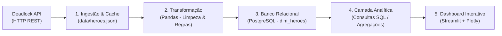

# 🎮 Deadlock Analytics

Plataforma de Engenharia e Análise de Dados para o jogo **Deadlock** (Valve), utilizando a [Deadlock API](https://deadlock-api.com) para construção de pipelines de dados, modelagem relacional no PostgreSQL e dashboards analíticos interativos.

---

## 📌 Arquitetura da Solução

O projeto segue um pipeline clássico de dados em camadas (ETL/ELT):



1. **Ingestão (Extract):** Coleta de dados via API REST com cache local para economia de requisições.
2. **Transformação (Transform):** Filtragem de metadados, tipagem e aplicação de regras de negócio (ex: heróis descontinuados).
3. **Persistência (Load):** Modelagem dimensional armazenada em PostgreSQL (`deadlock_db`).
4. **Camada Analítica & Visualização:** Consultas SQL consolidadas e dashboards interativos com Streamlit.

---

## 🚀 Como Executar o Projeto Localmente

### 1. Pré-requisitos
- Python 3.10+
- PostgreSQL instalado e em execução

### 2. Configuração do Ambiente Virtual
```bash
# 1. Clone o repositório e acesse a pasta
cd deadlock_api

# 2. Crie e ative o ambiente virtual
python3 -m venv .venv
source .venv/bin/activate  # No Linux/Mac
# .venv\Scripts\activate   # No Windows

# 3. Instale as dependências
pip install -r requirements.txt
```

### 3. Configuração do Banco de Dados
Crie um banco de dados no PostgreSQL chamado `deadlock_db`:
```bash
createdb -h localhost -U seu_usuario deadlock_db
```

Crie o arquivo `.env` na raiz do projeto com as suas credenciais:
```env
DB_HOST=localhost
DB_PORT=5432
DB_NAME=deadlock_db
DB_USER=seu_usuario
DB_PASSWORD=sua_senha
```

### 4. Executando o Pipeline
```bash
python src/main.py
```

---

## 📋 Checklist de Progresso do Projeto

Marque `[x]` nas tarefas concluídas conforme o avanço do desenvolvimento.

### ✅ Fase 0: Exploração e Planejamento
- [x] Mapear endpoints principais da Deadlock API (`/v1/assets/heroes`).
- [x] Testar chamadas HTTP iniciais e inspecionar retornos JSON.
- [x] Identificar regra de heróis descontinuados/testes da Valve (`player_selectable`, `disabled`).
- [x] Definir arquitetura em camadas e roadmap do projeto.

### ✅ Fase 1: Estrutura do Projeto e Primeiro Coletor
- [x] Configurar ambiente virtual (`.venv`) e dependências (`requirements.txt`).
- [x] Implementar cliente HTTP para consumo de heróis em `src/main.py`.
- [x] Criar sistema de cache local (`data/heroes.json`) para persistência de dados brutos (Raw).
- [x] Criar função de transformação com Pandas (`transform_heroes`) para filtrar colunas essenciais.
- [x] Criar regra de classificação: `is_active = player_selectable AND NOT disabled`.

### ✅ Fase 2: PostgreSQL e Persistência
- [x] Instalar e configurar instância local do PostgreSQL.
- [x] Configurar variáveis de ambiente seguras (`.env`) e proteção no `.gitignore`.
- [x] Criar módulo de conexão com SQLAlchemy e psycopg2 (`src/database.py`).
- [x] Implementar teste de conexão (*smoke test*) com o banco.
- [x] Criar rotina para persistir o DataFrame na tabela dimensional `dim_heroes`.
- [x] Validar inserção de 65 heróis (44 ativos e 21 protótipos/descontinuados).

---

### ✅ Fase 3: Qualidade, Modularização e Validações
- [x] Separar a lógica em pastas modulares (`src/ingestion/`, `src/transformations/`, `src/database/`, `src/pipelines/`).
- [x] Implementar tratamento de exceções robusto (timeouts de rede, falhas de banco).
- [x] Criar cliente HTTP reutilizável com logging padronizado (`DeadlockAPIClient`).
- [x] Implementar logs padronizados de execução com a biblioteca `logging`.
- [x] Orquestrar pipeline unificado de ponta a ponta (`src/pipelines/run_pipeline.py`).

### ✅ Fase 4: Módulo 1 — Dashboard do Meta (Estatísticas de Heróis)
- [x] Consumir endpoint de estatísticas agregadas (`/v1/analytics/hero-stats`).
- [x] Criar tabela de fatos `fact_hero_stats` no PostgreSQL (Win Rate, Pick Rate, partidas jogadas).
- [x] Criar consultas SQL analíticas com `JOIN` entre `dim_heroes` e `fact_hero_stats`.
- [x] Configurar aplicação Streamlit básica (`app/Home.py`).
- [x] Construir gráfico interativo de dispersão (Win Rate vs. Pick Rate) com Plotly.
- [x] Adicionar filtro interativo para ocultar heróis de teste/descontinuados.

### ✅ Fase 5: Módulo 2 — Eficiência de Itens e Builds
- [x] Consumir catálogo de itens (`/v1/assets/items`) e persistir em `dim_items`.
- [x] Mapear estatísticas de itens e builds mais populares (`fact_hero_build_items`).
- [x] Criar página no dashboard para catálogo e eficácia de itens (`app/Home.py`).
- [x] Implementar análise comparativa de builds por herói divididas por Early, Mid e Late Game.

### ⏳ Fase 6: Módulo 3 — Desempenho Pessoal de Jogadores
- [ ] Implementar consulta de perfil de jogador por ID/SteamID.
- [ ] Extrair histórico de partidas recentes e estatísticas por herói.
- [ ] Criar página de perfil analítico individual no Streamlit.

### ⏳ Fase 7: Módulo 4 — Análise Detalhada de Partidas
- [ ] Consumir metadados completos de partidas específicas (`/v1/matches/{match_id}`).
- [ ] Estruturar comparação entre equipes, patrimônio (net worth) e tempo de partida.
- [ ] Criar visualizador visual de partidas.

### ⏳ Fase 8: Testes Automatizados e Documentação Final
- [ ] Criar testes unitários com `pytest` para funções de transformação.
- [ ] Configurar testes de integração para o banco de dados.
- [ ] Adicionar capturas de tela dos dashboards no README.
- [ ] Documentar lições aprendidas e publicar no GitHub/LinkedIn.

---

## 🗃️ Modelo de Dados Atual

```
                    ┌─────────────────────────┐
                    │       dim_heroes        │
                    ├─────────────────────────┤
                    │ hero_id (PK, INT)       │
                    │ name (VARCHAR)          │
                    │ class_name (VARCHAR)    │
                    │ hero_type (VARCHAR)     │
                    │ is_active (BOOLEAN)     │
                    │ in_development (BOOLEAN)│
                    └─────────────────────────┘
```

---

## 💡 Principais Decisões Técnicas

1. **Heróis Descontinuados / Testes:** A Valve mantém protótipos antigos no jogo (ex: `Kali`, `hero_testhero`). Em vez de excluí-los (o que quebraria integridade referencial com partidas antigas), adicionamos a flag `is_active = True/False`.
2. **Separação Raw vs Relacional:** O JSON original é preservado em disco sem alterações. O banco relacional armazena apenas dados limpos e modelados.
3. **Segurança de Credenciais:** As credenciais do PostgreSQL são mantidas exclusivamente no `.env` e protegidas pelo `.gitignore`.

